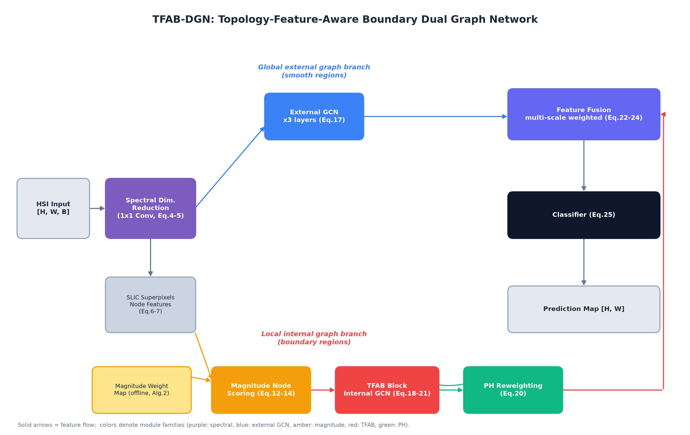

# TFAB-DGN: Topology-Feature-Aware Boundary Dual Graph Network

This repository provides the official PyTorch implementation of **TFAB-DGN**
(Topology-Feature-Aware Boundary Dual Graph Network) for hyperspectral image
(HSI) classification.

> **Jie Qian and Yi Tang**, "Topology-Guided Boundary-Aware Feature Learning
> for Hyperspectral Image Classification With Dual Graph Networks,"
> *IEEE Transactions on Geoscience and Remote Sensing*, 2026.

## Overview

Spectral variability and boundary ambiguity fundamentally undermine HSI
classification. TFAB-DGN integrates two algebraic-topology tools into graph
convolutional networks:

- **Magnitude** — a high-sensitivity boundary detector that quantifies the
  spectral–spatial heterogeneity of each pixel, used to score and select the
  hard-to-classify boundary superpixel nodes.
- **Persistent Homology (PH)** — extracts multiscale topological invariants
  (connected components and cycles) to recalibrate the internal-graph adjacency
  matrix, pruning misleading inter-class edges.

The dual-graph architecture hierarchically combines a global external graph
(smooth regions) with a local internal graph (boundary regions), producing
state-of-the-art classification with clear, accurate boundaries.



## Method Pipeline

1. **Graph initialization** — band-wise min-max normalization, 1×1-convolution
   spectral dimensionality reduction, and SLIC superpixel segmentation.
2. **Local magnitude calculation** — offline computation of a magnitude weight
   map for boundary localization (Algorithm 2).
3. **Magnitude node scoring** — fuses an MLP score with the magnitude prior to
   select Top-*k* boundary nodes (Eq. 12–14).
4. **Dual graph network** — an external GCN for smooth nodes and a TFAB block
   (PH-reweighted GCN) for boundary nodes (Eq. 17–21).
5. **Feature fusion & classification** — multi-scale weighted fusion, a
   spectral–spatial CNN, and a softmax classifier (Eq. 22–25).

## Repository Structure

```
TFAB-DGN/
├── models/
│   ├── tfab_dgn.py        # full TFAB-DGN model + sub-modules
│   └── __init__.py
├── utils/
│   ├── slic.py            # SLIC segmentation & graph construction
│   ├── magnitude.py       # offline magnitude weight map
│   ├── metrics.py         # sampling, evaluation, visualization
│   └── __init__.py
├── datasets/              # put the .mat files here
├── main.py                # training / evaluation entry point
├── requirements.txt
└── README.md
```

## Installation

```bash
conda create -n tfab python=3.11 -y
conda activate tfab
pip install -r requirements.txt
```

> `gudhi` provides the persistent-homology backend. On Windows, prefer
> `conda install -c conda-forge gudhi`.

## Dataset Preparation

Download the four benchmark datasets and place them under `datasets/` with the
following layout (the code reads `.mat` files):

```
datasets/
├── Indian_pines/Indian_pines_corrected.mat, Indian_pines_gt.mat
├── PaviaU/PaviaU.mat, PaviaU_gt.mat
├── Salinas/Salinas_corrected.mat, Salinas_gt.mat
└── WHU-Hi/WHU-Hi-LongKou/WHU_Hi_LongKou.mat, WHU_Hi_LongKou_gt.mat
```

The magnitude weight map is precomputed automatically on the first run and
cached under `results/magnitude/`.

## Training

```bash
python main.py --dataset IP --seed 0
python main.py --dataset PU
python main.py --dataset SA
python main.py --dataset LK
```

Default configurations (30 training samples per class):

| Dataset | scale | mid_dim | top_k | epochs |
|---------|-------|---------|-------|--------|
| IP      | 60    | 50      | 5     | 200    |
| PU      | 150   | 50      | 5     | 150    |
| SA      | 300   | 50      | 3     | 150    |
| LK      | 450   | 40      | 3     | 150    |

Results (classification maps, best model weights, and metrics) are saved under
`results/<dataset>/`.

## Citation

If you find this work useful, please cite:

```bibtex
@article{qian2026topology,
  title={Topology-Guided Boundary-Aware Feature Learning for Hyperspectral
         Image Classification With Dual Graph Networks},
  author={Qian, Jie and Tang, Yi},
  journal={IEEE Transactions on Geoscience and Remote Sensing},
  year={2026}
}
```

## License

This project is released for academic research purposes only.
